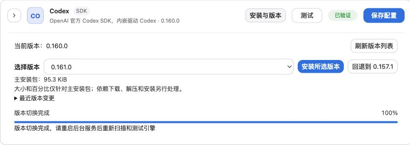
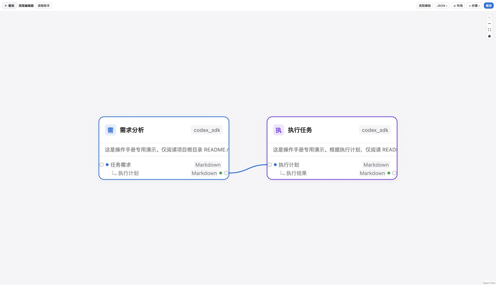
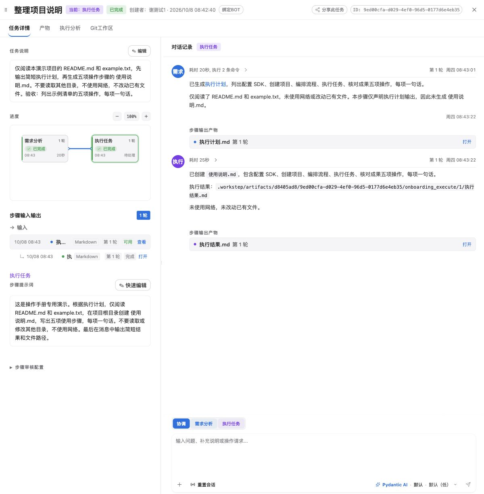
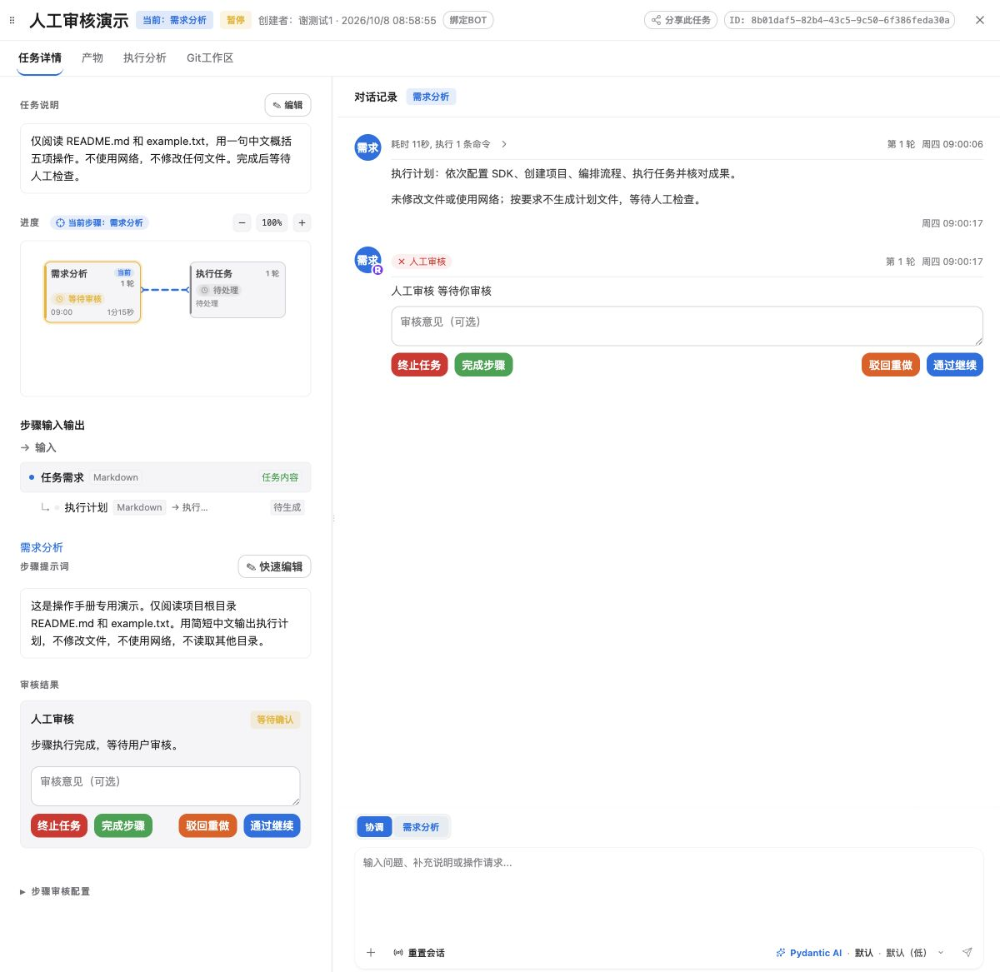

<div align="center">


# WorkStep

### Let AI develop in steps. Keep key decisions in your hands.

WorkStep is an AI development workspace for individual developers and small teams. Connect coding tools like Codex and Claude Code into reusable steps for planning, implementation, testing, and review.

[Website](https://xzregg.github.io/workstep/) · [Download](https://github.com/xzregg/workstep/releases/latest) · [User manual](https://xzregg.github.io/workstep/#docs) · [Developer docs](docs/README.md) · [简体中文](README.zh-CN.md)

[](https://github.com/xzregg/workstep/actions/workflows/ci.yml)
[](https://github.com/xzregg/workstep/releases/latest)
[](LICENSE)


</div>

## What can you do with it?

For example, to add search to an existing project, configure a workflow like this:

1. **Analyze requirements**: define the search scope and constraints, then produce an implementation plan.
2. **Implement the feature**: change the code according to the plan and explain which files changed.
3. **Run tests**: execute the agreed test commands and record results and outstanding issues.
4. **Review changes**: inspect the code and test results. With manual review enabled, approve the step or provide feedback for rework.

This is a workflow design example; actual results need checking. WorkStep connects steps, passes results, and records progress. Execution comes from the tools and models you configure. Steps can share one engine, so you do not need to install every tool.

Reuse the workflow for later tasks to reduce repeated briefing, manual handoffs, and progress checks.

## Download the desktop app (recommended)

Visit [GitHub Releases](https://github.com/xzregg/workstep/releases/latest), download the package for your system, then install and open WorkStep:

- **macOS Apple Silicon**: ARM64 DMG or ZIP
- **macOS Intel**: x64 DMG or ZIP
- **Windows x64**: NSIS installer
- **Linux x64**: AppImage

Desktop packages include the backend; no separate Python installation is required. Install an optional execution engine from the app when you are ready.

> Desktop packages are currently unsigned early-access builds. Windows SmartScreen or macOS Gatekeeper may show a first-run warning.

### What do you need for your first task?

1. Open **Settings → Execution engines** and install one engine, such as Codex SDK or Claude Agent SDK. An engine is the AI program that reads files, changes code, and calls tools. You can install it through the interface.
2. Configure authentication and a model service as required by the engine, test it, and save your execution defaults. Installing WorkStep or an engine does not provide model accounts or credentials. Model service fees follow your chosen provider’s terms.
3. Add a project, use onboarding to create the two-step analysis and execution example, then create and start a task.
4. Begin with an easy-to-check task, such as reading demo materials and generating a usage guide. Inspect the files before using the workflow on your own development project.

Follow the [setup guide](https://xzregg.github.io/workstep/#docs/getting-started) and [first-task walkthrough](https://xzregg.github.io/workstep/#docs/first-task) for detailed steps. Local standalone use does not require gateway login; external model services still require their own authentication.

## See it in action

Real screenshots from the demo project (Chinese interface). The starter task reads demo materials, produces a plan, and creates a usage guide so you can check the handoff between steps and inspect the file. Click an image to view it at full size. Follow the [user manual](https://xzregg.github.io/workstep/#docs) for detailed instructions.

### 1. Install an SDK engine

Open engine settings, choose an SDK engine, and use **Install & version** to download it. Configure authentication, test the connection, and select the default engine. SDKs are the recommended starting point.

[](apps/landing/src/manual/screenshots/sdk-install-version.jpg)

### 2. Connect steps on the workflow canvas

Add steps and connect their inputs and outputs. This example passes a Markdown execution plan from **requirements analysis** to **task execution**; each step shows its engine.

[](apps/landing/src/manual/screenshots/workflow-canvas.jpg)

### 3. Run a task and inspect its results

Create a task with your requirements, then follow each step's progress and conversation. The completed example shows both steps and links to the generated plan and execution result.

[](apps/landing/src/manual/screenshots/first-task-result.jpg)

### 4. Review before continuing

Enable manual review on a step to wait for your decision. Inspect the output, add feedback, then approve and continue, request rework, complete the step, or stop the task.

[](apps/landing/src/manual/screenshots/task-review.jpg)

## Core capabilities

| | Capability | What it gives you |
|---|---|---|
| 🎛️ | **Configure development steps** | Build sequential, parallel, review, and rework stages on a reusable workflow canvas. |
| 🤖 | **Choose AI coding tools** | Use CLI, SDK, ACP, and harness-based engines without redesigning the workflow around one vendor. |
| 👁️ | **Follow execution** | Follow streaming responses, tool calls, execution state, structured events, and step history. |
| 🛡️ | **Human control** | Approve sensitive tools, pause or stop work, resume sessions, and retry failed stages. |
| 💾 | **Local-first storage** | Keep project data, execution records, and artifacts on your device or infrastructure. |
| 🔁 | **Recoverable context** | Continue tasks and supported engine sessions after interruption or restart. |
| 📦 | **Web and desktop** | Run from source or use unsigned early-access packages for macOS Apple Silicon / macOS Intel, Windows x64, and Linux x64. |
| 🔗 | **Controlled collaboration** | Authorize remote access per project and device instead of uploading every project to a central service. |

## Engines, one workflow model

WorkStep currently integrates engines including:

`Codex CLI` · `Codex SDK` · `Claude Code` · `Claude Agent SDK` · `OpenCode` · `OpenClaw` · `Hermes ACP` · `Cursor SDK` · `Qoder SDK` · `DeepSeek Harness` · `Pydantic AI`

Choose and configure one to get started. Session recovery, approvals, and other capabilities vary by engine; see the [engine capability guide](docs/llm-engine-development-guide.md).

## Local-first by design

1. Project data and execution records stay on your machine, next to the project by default or in a configurable central location.
2. Engines execute through the local daemon; WorkStep does not silently copy projects into a hosted workspace.
3. Optional remote access is explicit, scoped to a project and device, and can be revoked by the project owner.

Local-first describes where WorkStep stores and orchestrates project data. External model providers and optional engines still follow their own network and data policies.

## Other ways to run (development and self-hosting)

### Run from source

Requirements: Python 3.11+, [uv](https://docs.astral.sh/uv/), Node.js 20 or 22, Yarn (available through Corepack), Bash, and `lsof`. For macOS / Linux; on Windows, use the desktop app or Docker.

```bash
git clone https://github.com/xzregg/workstep.git
cd workstep
./start.sh
```

The script installs dependencies and starts both services. Open <http://127.0.0.1:5173> and press `Ctrl+C` to stop. See the [development guide](docs/development.md) for more commands.

### Run with Docker

Install Docker and Docker Compose, then run:

```bash
git clone https://github.com/xzregg/workstep.git
cd workstep
docker compose -f docker-compose.yaml up -d --build workstep
```

After the build finishes, open <http://localhost:8755>. Configuration and engines persist in `./data/home`, and projects in `./data/projects`; use `/data/projects/<project-name>` when creating a project in the app. For older Compose versions, replace `docker compose` with `docker-compose`. See the [container guide](docs/container-runtime.md) for more options.

## Documentation

- [User manual — SDK setup, workflows, tasks, and troubleshooting](https://xzregg.github.io/workstep/#docs)
- [Product overview](docs/overview.md)
- [Architecture and data flow](docs/architecture.md)
- [Workflow execution](docs/workflow-engine-execution.md)
- [LLM engine development](docs/llm-engine-development-guide.md)
- [Desktop sandbox mode](docs/desktop-sandbox.md)
- [Development guide](docs/development.md)
- [Security policy](SECURITY.md)

## Community and contributing

Read [CONTRIBUTING.md](CONTRIBUTING.md) before opening a pull request. Use [Issues](https://github.com/xzregg/workstep/issues) for reproducible bugs and actionable feature requests, and [Discussions](https://github.com/xzregg/workstep/discussions) for questions, ideas, and design exploration. Report security issues privately as described in [SECURITY.md](SECURITY.md).

## Star History

<a href="https://www.star-history.com/?repos=xzregg%2Fworkstep&amp;type=date&amp;legend=top-left">
  <picture>
    <source media="(prefers-color-scheme: dark)" srcset="https://api.star-history.com/chart?repos=xzregg/workstep&amp;type=date&amp;theme=dark&amp;legend=top-left" />
    <source media="(prefers-color-scheme: light)" srcset="https://api.star-history.com/chart?repos=xzregg/workstep&amp;type=date&amp;legend=top-left" />
    
  </picture>
</a>

## License

WorkStep is licensed under the [Apache License 2.0](LICENSE). Optional third-party engines and services remain under their own terms; see [THIRD_PARTY_NOTICES.md](THIRD_PARTY_NOTICES.md).
