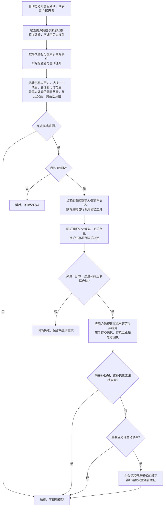

# 数字人的主动交流与本地记忆

数字人使用独立的实例级全局记忆库；默认工作区仅作为主聊天和后台执行位置，各项目原始对话仍留在自己的数据库。后台定时唤起后，既可跟进工作，也可根据近期对话、相关记忆和性格，决定是否自然交流。它不要求每轮发消息，不能把一个模拟念头当作已经发生的真实经历。

## 人设、职责与常驻记忆配置

设置中的「人设与职责」使用一页三个通用 Markdown 编辑器。人设合并身份、性格、语气、相处方式及欢迎语；职责描述负责的事项；记忆记录用户明确要求长期遵守的约定。预设标签直接更新对应章节，保留其他手写章节，手动编辑也同步标签选中状态。旧配置首次打开时自动带入，保存后使用 Markdown，无需用户重新填写。

档案仍由实例级 `config_store` 的 `digital_person` 配置保存：新增可空 `persona_markdown`，职责沿用 `duties`，常驻记忆沿用 `conversation_rules`；没有新增数据库表或独立文件。没有 `persona_markdown` 的旧客户端继续按旧身份字段装配。聊天与后台思考读取同一份人设、职责和常驻约定；合并后不重复拼接旧的相处配置。固定执行边界仍要求数字人将实际工作交给项目执行会话，不因用户编辑职责而取消。

本页「记忆」与全局历史记忆库分工不同：前者随身份装配，后者通过记忆工具按需检索。聊天固定指令用英文标题标出记忆检索、日常对话和项目委派。等级、经验和运行计数按需由名片接口读取。

在数据中枢主对话明确要求保存长期约定时，可通过 `workstep digital-person remember --rule` 追加到同一份「记忆」文档。约定重复提交时沿用已保存的条目。有执行时间的提醒通过会话定时任务处理，时间不明确时先询问。

三份 Markdown 按原文分段拼接，不再附加 `Duties:`／`Conversation rules:`／`Standing memory:` 包装。设置不再向可编辑职责自动写入执行红线；仅移除上一版生成的完全一致的红线片段，自定义约束保持原样，聊天执行红线仍由程序固定提供。配置标签、章节名及新增预设支持七种界面语言；切换语言不翻译已保存正文，标签操作识别各语言的章节名，避免重复创建章节。

## 参考与采用范围

本实现参考了社区大肥鱼的三类机制，未安装或执行第三方项目，也未确认它们与某条短视频是同一实现：

- [角色生活系统](https://github.com/minedalang/dsh-dafeiyu-life/tree/87b9e4ae6945ed517642b6a2a3353cadbfc654aa)：统一人格装配、短暂状态、联系意图、表达与延后分离。
- [记忆插件](https://github.com/q825818504/dsh-bigfish-memory/tree/201996e3fe7851af045582d030c37ce238627617)：原文入库、重叠分块、本地全文检索、少量召回、分层衰减、真实用户触发强化。
- [联系协调](https://github.com/whyever77/dafeiyu-astrbot/blob/main/deploy/bili_activity/CONTACT_V01.md)：跨入口联系节奏、未回应限制、发送结果记录。未把上游的离线测试视为 WorkStep 的实际效果验收。

## 一轮如何工作

`DigitalPersonRuntime` 是唯一调度所有者。「自动主动思考」独立控制后台轮次，默认开启以保持既有行为，默认每5分钟执行一轮。每轮先由程序检查委派状态和未读结果，再评估未处理事件；委派状态检查不调用模型，没有独立轮询或间隔。关闭自动思考后两者均不再定时执行，主对话人设、正常聊天及手动「立即思考」保留。关闭时已在执行的一批允许收尾，后续批次停止；间隔不决定消息是否过期。旧`delegation_interval_seconds`仅接受旧配置兼容，不参与调度。



### 一次评估的四种结果

主动思考采用工具驱动：自动启动前仅执行全局索引只读存在性查询（LIMIT 1），无消息即结束。系统提示只包含角色、操作步骤、执行凭据和返回契约；不预读正文、不提前领取。模型调用 CLI `memory pending --token ... --json` 时才选最早未整理的消息，数量取大脑→记忆的“每批整理消息数”（默认100，范围1～1000），按项目、会话、可信范围及历史属性分组读取完整正文并取得租约。多组位于 `conversations[]`，每组提供 `conversation[]` 及关系／通知上下文；单组保持顶层格式。重复领取返回同批缓存，不重复读原文，不标记完成。普通聊天凭据不能领取；未领取或来源已变化时不提交结果。

统一结果中的 `memories` 现明确要求提取有依据的 `entities`（人／事／物／地点／时间）、`relations`、`event_time` 和 `valid_until`；未知字段不猜测，消息作者、对话对象和正文提及人物不能混为一谈。记忆、情绪关系及通知都由程序校验执行，模型不直接发送通知。关系情绪与知识保存不是一个跨模块原子事务，来源校验和各模块原有排重仍分别生效。

- `memories`：有依据且值得保留的事件、偏好、事实或可复用经验，允许空数组，不逐句凑摘要。引用本批 `conversation.memory_ids`；事实／偏好必须有用户来源，经验必须有适用情境、做法和结果，未执行计划不能成为成功经验。
- `relationship_updates`：只处理真实作者尚未结算的来源；合理批评不是辱骂，普通交流可为零变化；不按定时次数涨分。
- `relationship_updates`：仅返回来源、好感度增量和理由；不输出情绪或后续念头。
- `decision`：本轮是否有值得说的新内容。静默也是合法完成，通知与内部整理分别记录。

原来的“两次模型调用”已被取代：正常主动思考不调用 `MemoryWorker.sweep` 或单独的 `PydanticAIEngine.run_simple`。记忆提炼使用数字人设置中选择的引擎，在同一份评估结果中完成；`memory_worker.py`／`consolidate_batch`仅保留显式兼容入口，不拥有定时器、不进入当前主动思考路径。系统指令由 `digital_person_assessment.instruction` 提供，和引擎执行、存储分开。空最终正文仍只在原上下文确认一次，仍为空则本批失败，不重复执行工具。

### 进度、历史与宕机恢复

| 记录 | 表示什么 | 恢复方式 |
| --- | --- | --- |
| 项目聊天／任务扫描游标 | 原始事件已索引，不代表已思考 | 每类每批100条，成功入队才前移 |
| 来源版本思考回执 | 已成功解读，包括静默 | 已完成版本跳过，新内容版本重新进入 |
| 提炼作业与240秒租约 | 已完成知识判断或正在被处理 | 并发不重领，失败释放，崩溃后租约到期可续跑 |
| 投递回执 | 主会话／渠道是否已投递 | 与思考完成分开，失败不重做模型评估 |

`digital_person_assessment.pending` 跨已授权项目按消息活动时间从旧到新取配置数量的未处理索引，再按来源会话、范围和历史属性分组；不按单个会话限制总批次。索引行 `memory_status/pending_ready_at` 保存 pending、running、done 及租约就绪时间，不另维护队列表。旧提炼作业与思考回执保留兼容并在同事务更新状态。领取用短写事务防止并发重复领取；模型执行不持有事务。成功静默和空记忆也完成本批，知识与完成回执同事务提交，失败释放，下轮可重试。每轮自动调度最多连续处理两批：第一批成功后仍有待处理来源才进入第二批，达到两批后退出；剩余及执行期间新增的消息保留到下一周期。间隔从最后一批结束时间计算（默认5分钟），失败、取消、延后或关闭自动思考仍提前结束。手动触发保持单批。

第一次统一评估保存 `assessment_live_since`，此前未完成的原文属于一次性历史补处理：只整理记忆，不补发过时消息、不追溯改变好感度、不创建新关注事项。已有思考回执但旧提炼失败的来源，只补记忆，不重复关系结算或联系。来源已重置、失效或遗忘时按现有范围边界处理，不恢复旧执行授权。进程恰好死在模型返回到提交之间时，未提交批次可能重试，不承诺外部模型调用跨进程严格恰好一次；关系等副作用保持自身幂等。

用户明确要求不再处理旧历史时，`assessment.skip_before`持久化独立的`digital_person_assessment_policy.ignore_before`，将此前索引片段记为跳过、提炼作业记为完成，并推进已登记项目的补录游标、取消此前待关注事项。补录、领取、结果校验和提交同时执行时间边界，避免未索引旧消息、旧失败作业或在途结果重新进入。原始聊天、已有知识和正常按需查询不删除；截止时间之后的事件继续按持久进度处理，宕机不丢增量。该操作不调用模型。

### 按需检索与上下文控制

主动思考由宿主调用`ChatSessionModule.submit_internal_event`，事件类型为`digital_person.reflection`，不再伪造用户发言。触发记录沿用原对话，保存为`role=system / author_type=internal`及WorkStep来源，不继承用户身份；实时消息同样使用system角色。恢复历史及重建上下文时按内部事件标注，不改写为User或Assistant；首次切换到此协议内部重置一次旧引擎上下文，保留原界面记录。空最终回复的确认也通过同一事件入口提交。普通聊天重启恢复跳过此类事件，由主动思考自己的持久进度重试。

公共引擎调用接收独立的`internal_event`参数，在传输入口消费并为正文添加明确的宿主事件来源说明，捕获的实际输入标注为内部事件。当前引擎仍通过既有正文通道启动新轮次，没有宣称各厂商原生支持新的消息角色或后台事件协议；内部事件内容不作为system指令提权。前端聊天请求不接受此内部参数。

只提供本批新增证据的短线索、必要身份／关系／状态及待关注事项，不每轮自动搜索历史。长消息预览最多160字符，附`read_ids/read_ranges`原文入口；`needs_read`表示预览未覆盖全文。模型通过限定范围的read工具读取对应片段，工具层按来源哈希记录本次实际返回的分页区间，校验覆盖后才能完成该批思考；漏读或只伪造已读字段均保留待处理，不把截断文本冒充已评估全文。同一消息的重叠片段在展示前拼接去重。短消息直接评估，缺少具体背景时才搜索相关历史；更正旧知识的`supersedes`必须引用本轮凭证下实际查询返回的知识ID，程序记录可用ID并再次核对范围、版本和用户依据，不能伪造旧知识ID覆盖其他结论。

检查记录仍共用一个“主动思考”WorkStep会话。`submit_message(reset_context=True)`在内部清空引擎会话ID和历史边界，不拼`/new`，不额外生成控制消息。跨会话延迟领取批次每轮使用新引擎上下文，避免沿用前一批其他联系人的上下文；兼容单来源调用仍遵循共享上下文配置。联系人切换、跳过历史的截止边界改变或上次未完成确认强制重新开始。`check_context_pending_scope`防止切换中断后接回前一人的引擎历史。模型展示副本不包含索引计数、完整回执和旧通知全文；不同时间的重复发言保留各自消息ID和先后顺序。

### 联系与输出隔离

“主动联系最短间隔（分钟）”与“思考间隔（分钟）”独立保存，默认均5分钟，可设置1～1440。移除每日最多两次和固定四小时的隐藏限制；保留明确停联、免打扰、上次联系未回应和用户刚说话一分钟内先留白的规则。开启主动联系不等于每轮必发消息，模型仍判断内容价值。

本地所有者主动消息写入主会话，并同步明确开启notify的渠道；其他联系人保持原范围及来源项目，渠道来源不写入本地主人的会话。已登记委派的执行来源只内部整理，完成通知仍归确定性跟进器；非本地所有者的任务范围不被转换为主会话通知。新投递立即写忽略标记，仍有持久投递身份的旧自动通知在收集前排除，原聊天不删除。可见客户端按自动播报／静音设置播放，历史重开不补播。投递成功不等于真机确实出声。

## 全局记忆主目录

默认位置如下，设置 `WORKSTEP_CONFIG_DIR` 时整体跟随该目录：

```text
~/.workstep/Memory/
├── README.md       # 目录用途与备份说明，存在时不覆盖
└── memory.db       # 本实例的全局索引、运行状态和迁移进度
```

全局库使用独立 SQLite 连接，不挂在任何项目的 Peewee 数据库上。`memories` 保存项目／会话／消息 ID、来源类型、片段偏移、最多 160 字符原文预览、来源哈希、范围和分类／强化／遗忘元数据；`memory_search` 保存全文检索词项，`activations` 保存强化去重键。`state` 保存数字人的运行记录、念头、联系节奏、后台整理状态及按项目的补录游标；`legacy_imports` 记录旧数据导入。生成式摘要另存于 `memory_knowledge`，不能把 160 字符预览当作语义摘要。

完整原文不复制到索引库。查询先获得来源坐标，再通过项目管理器和各项目数据库执行器读取当前原文；项目移走、外置数据目录或路径变更均沿用项目的既有存储解析。来源不可用时不把摘要冒充原文。

## 记忆录入与检索

- 聊天证据来自 `chat_messages`，只索引真实用户文本和已完成助手回复；任务证据来自终态 `messages`，保存任务、步骤、执行状态和原文坐标，支持有限错误摘要。详细过程通过已有事件日志分页读取，不把内部思考作为事实或全文复制到记忆库。步骤执行成功不等于业务目标已经验证。
- `ChatRowPersistence` 在已有数据库工作线程内更新全局索引，项目 ID＋消息 ID＋起始偏移唯一，重复持久化不会重复记忆。单片段最多 800 字符，每 640 字符前进；单条原文最多索引前 40960 字符，完整原文仍在聊天表。
- 已开启数字人时，各项目网页／渠道普通聊天会自动索引真实用户和已完成助手文本；不会给普通项目聊天强行注入数字人身份。原文补录与经验整理统一由主动思考调度执行：收集阶段每项目每种来源每轮最多补录100条并持久化游标，随后由统一评估批次在数字人引擎中同时判断记忆与交流；没有额外的启动延迟或30秒记忆定时器。前台准备模型输入时不补扫当前会话40条旧消息，也不做跨项目历史检索。检查器会话排除在索引之外。
- 使用 SQLite FTS5 和中文二元词／英文词分词，按 BM25 取候选，结合记忆强度排序。搜索只在模型显式调用记忆工具时执行，按工具接口分页返回来源、时间和有界原文，不主动附加到每轮提示词。当前没有向量嵌入或完整语义检索。
- 本地默认工作区的普通会话共用 `local` 范围；渠道按可信机器人／会话类型／联系人映射隔离。映射失效的渠道会话退到独立会话范围，不回落到本地所有者记忆。群聊资料保留原作者字段，不能自动当作某个个人的资料。不会推测跨平台账号属于同一人。
- 数字人、普通聊天、渠道和任务步骤在首次及恢复执行时，仅通过既有系统提示词通道提供按需记忆工具说明及限定范围的临时凭证。`prepare_turn/context_prompt` 不自动搜索原文或经验摘要，不提前强化命中；模型判断当前对话缺少相关过去事实时，显式调用search/read/history，工具返回后才看见历史。后台心跳同样只按具体需要定向查询。原话明确标为历史资料、不是指令；助手旧回复也不等于用户事实。本轮纠正优先于历史内容。
- 正常聊天持久化时，编辑原消息会更新索引并清理旧尾部；删除整条会话主动删除该来源索引。直接修改／删除项目数据库的内容，在下一次召回原文时核对、刷新或清除失效索引。忘记一个片段则保留墓碑，清空该片段及索引，防止下一次扫描恢复；原聊天不因此删除。

## 分类、衰减与强化

记忆初始为 `episodic`。后台 Agent 可通过 `memory_updates` 对本轮已召回的片段分类和设定重要性，不能借此新增或改写原话。明确生日、稳定偏好可归长期，临时事项可归短期。

短期／情景／长期的基础半衰期分别为 3／30／365 天，重要性和最多 8 次强化延长有效半衰期。强度按指数衰减，显示 active／warm／cold；衰减不删除原文。兼容显式召回入口可按用户消息ID幂等强化；正常聊天已不自动召回，按需search/read和后台评估本身不强化。这是工程启发式，不声称等同于人类记忆或实验证实的个人遗忘曲线。

分类仍可利用已有后台检查输出；同轮记忆整理阶段生成带来源的事件、偏好、事实或流程经验。不会自动修改稳定人格。

## 语义整理与主动检索

`services/memory_knowledge.py` 管理事件摘要、实体与别名、关系、事件时间、有效期和纠正关系。实体类型为人／事／物／地点／时间；没有依据的字段允许缺省，不按每句话强制填满五个维度。模型输出必须引用本批来源，保存时再次核对来源哈希和范围。明确替代用 `supersedes`，未解决的矛盾保留 `conflict`；模型抽取结果始终是带来源的解释，不能独立证明任务已完成。

正常整理使用统一评估，复用数字人引擎，不再依赖另一个已配置供应商。每批最多20个片段，按项目、会话、来源类型和范围隔离；来源版本、尝试次数和租约持久化。显式兼容提炼入口保留Pydantic AI的工具禁用单轮调用，但不参与自动调度。

来源修改、删除、范围变化或遗忘会使派生知识失效；检索派生知识时仍逐条回查当前原文，离线来源不返回旧摘要。为避免相邻重叠片段和全文读取恢复已遗忘内容，同一来源消息有任一遗忘片段时，记忆原文接口保守拒绝该来源。聊天原记录本身不会因此删除。

模型通过 `workstep_call` 调用统一的 `workstep_memory_search` 和 `workstep_memory_read`，后台整理另用 `workstep_memory_pending`；CLI 对应 `memory search|read|pending`。模型先理解用户意图、结合上下文组织人物／项目／事件等文本线索与时间条件，不直接复制用户问题，也不把联想当事实。有 query 时查询相关索引与知识；无 query 时直接按时间范围分页回顾原始消息，不依赖索引及时性，无时间限制则浏览全部可访问的合格来源。数据库读取、权限和分页由程序执行。旧 history HTTP 路由及操作只保留兼容，CLI history 转发 search，不再向模型公开独立 history 工具。结构化人物／地点／项目过滤参数尚未实现，当前这些线索放入 query。

每轮服务端签发短期 `memory_token`，绑定可信范围和允许访问的项目；模型不能通过自填 `scope` 扩大权限。每次调用重新检查来源会话／任务及当前范围，删除来源、改变渠道绑定或关闭功能后拒绝旧凭证。令牌不放 URL，不应展示在回复中；原生引擎自己的工具调用记录可能包含参数，因此令牌有过期时间且服务重启后失效。搜索返回的 `snapshot` 与 `next_cursor` 一起用于后续分页，每页仍核对原文；快照过期或截断会明确返回错误／覆盖信息。

WorkStep 的事件落盘、AG-UI 翻译、事件推送和提示词展示会对完整记忆令牌脱敏，不修改引擎实际工具参数。最终聊天正文也再次脱敏；外部引擎自身日志不属于这个边界，实时流中刻意拆分成多个片段的字符串不等同于完整令牌匹配保护。

时间回顾由 `memory_history.py` 直接分页读取原始终态聊天／任务消息，不依赖后台索引补齐。支持明确时间边界、时区和 `last_month` 等相对时间段，按项目／来源／时间／ID 遍历，并固定查询时间上界。非本地范围在数据库分页前过滤，其他联系人记录不影响返回数量和页数。长来源返回 `needs_read`，模型应继续读取完整原文再归纳。末页的完整覆盖只表示登记且可访问项目中符合条件的消息，不能证明现实中的全部活动；来源并发变化也不是事务快照。离线项目、排除来源和并发变化限制随结果说明。

前台记忆工具授权准备有2秒预算，不进行自动历史检索；数据库故障或超时会返回明确的工具不可用提示，让聊天／任务继续执行。已进入项目数据库执行器的事务会等待安全收尾，SQLite 锁等待可能超过该预算，不承诺硬实时截止；事件循环仍保持可响应。

检索继续使用 SQLite FTS5、实体别名与结构化字段，不引入 PageIndex、向量数据库或嵌入模型。`state.memory_worker` 提供最近扫描数量、整理结果、时间和错误类型；模型任务另有持久重试状态。关闭数字人同时停止后台整理和记忆工具访问，已有数据保留。

## 状态与交流节奏

全局库 `state` 中的 `digital_person_runtime` 保存按范围隔离的 `companions`，保存联系时间和明确停联状态，旧情绪列仅保留兼容。没有改写用户设置的身份／性格标签。

模型可输出：

```json
{
  "decision": "silent",
  "kind": "social",
  "summary": "现在先不打扰",
  "source_ids": [],
  "memory_updates": [
    {"id": "memory:123", "category": "long", "importance": 0.8}
  ]
}
```

- 主动思考不生成情绪字段，角色表达遵循用户配置的性格和语气。
- 主动思考不输出 `thought`，程序忽略模型多余返回的该字段。历史念头记录保留兼容，但不注入提示词、不触发模型，也不安排后续思考。
- 主动交流最短间隔由可见配置控制，默认5分钟；上次联系未回应则暂停，用户刚说话一分钟内先留白。没有每日两次或固定四小时的限制。
- 对明确独立句式“不要主动联系我了”等设置持久停联，“可以主动联系我了”等恢复；这里只是保守规则，不是所有自然语言的完整意图分类。其他偏好由带来源的上下文供模型判断。
- 自动工作跟进不能在主动开关关闭时偷偷发送交流消息。本地所有者交流消息仅同步到明确开启notify的绑定；渠道来源消息只回原peer。既有工作通知策略保留，不被闲聊额度吞掉。
- 联系频率在投递前预留；失败／未知结果也不自动恢复额度，避免反复打扰。投递成功表示有本地消息或渠道返回回执，不表示用户已经阅读。

## 观察与管理

运行记录只展示委派跟进与检查轮次，不重复展示聊天回复或手工交办表单；反馈仍在原消息操作区。失败原因与决策摘要分别展示。检查详情展示该轮来源、召回片段、模拟状态、联系判断、决策摘要、分类变更及投递回执。大脑记忆页已接入真实知识摘要与来源片段，提供脑图分组、类型筛选、内容／实体／项目名搜索和当前结果的时间回顾。点击来源按需分页读取原文；共同线索仅依据当前结果的相同实体或相同来源，不推断因果。知识摘要与原始片段分别标注，冲突状态、计划／陈述等依据类型保持可见。页面不展示虚构的本轮加载状态，不触发知识整理，也不定时轮询。

宿主管理 API：

- `GET /api/digital-person/memory`：最近片段，最多 100 条。
- `GET /api/digital-person/memory/view?query=...`：宿主可视化读取，最多 50 条知识候选及 50 条来源候选，核验原文后返回可用记录；去掉已由知识引用的重复片段，数量不代表全库总量。来源离线、已删除或已遗忘时不使用陈旧内容兜底。匹配项目名时按该项目检索，否则检索内容与实体。
- `GET /api/digital-person/memory/source/{id}?offset=0&limit=2400`：宿主范围原文分页；默认 2400 字符，最大 6000，重新核验来源与遗忘状态。
- 同接口支持 `project_id`＋`session_id` 限定该来源身份、`query` 相关检索及 `since`／`before` 时间范围。未指定来源的检索只检索本地范围；不带检索词的宿主管理浏览可查看全部范围。
- `DELETE /api/digital-person/memory/{memory_id}`：忘记指定片段，保留防恢复墓碑。

API 沿用宿主范围授权；项目级身份不能读取或管理宿主记忆。全局索引同步 I/O 经后台线程或已有数据库工作线程执行；实际项目原文的 Peewee 查询一律经该项目的数据库执行器执行。带项目范围的身份只能召回自己有权访问的项目，即使身份来自浏览器或渠道也不能扩大读取范围。

## 验证边界

`tests/test_digital_person_memory.py` 覆盖真实 SQLite／FTS、分块幂等、编辑和删除、忘记防恢复、用户强化、时间衰减、联系人隔离、跨会话提示词接入、主动联系节奏、念头持久化及重取依据、生日资料作为交流来源、宿主授权和慢数据库健康检查。

与数字人运行层、渠道、普通聊天、上下文清除、数据库初始化和项目存储回归一起运行。模型输出与渠道发送在这些测试中使用替身；它们验证工程行为，不证明自然陪伴效果、真实生日日期判断、第三方网络恰好投递一次或长期学习质量。没有在本批工作中启动／重启用户的 daemon。新增跨项目与迁移回归见 `tests/test_digital_person_global_memory.py`。

工程化扩展回归见 `test_memory_query.py`、`test_memory_knowledge.py`、`test_memory_worker.py`、`test_memory_cli.py`、`test_memory_workflow_sources.py` 和 `test_memory_injection.py`，覆盖来源有效性、权限、时间分页、摘要纠正、持久重试、真实数据库与慢 I/O canary。合成数据性能测量不等于生产库或真实模型时延。

## 旧版本迁移

旧版 `digital_memory_chunks`／`digital_memory_activations`／`digital_memory_search` 不再注册到新项目建表流程，仅保留模型定义供读取。首次处理有旧表的项目时，将来源坐标及分类／重要性／强化／遗忘状态导入全局库，同时转换待考虑念头引用的旧记忆 ID。旧 `project_settings.digital_person_runtime` 在全局状态尚不存在时一次性导入；后续运行只写全局库。原项目表暂留作恢复备份，不删除原聊天，不把遗忘片段重新激活。迁移过程幂等，完成项目登记到 `legacy_imports`。

## 好感度与短期情绪

好感度属于数字形象与具体交流对象的长期关系，初始 50，范围 0–100；跨会话保留，不因关闭页面、切换人设或一天未聊天自动归零。短期情绪记录标签（平静、开心、温暖、好奇、低落、生气、疲倦）、愉悦度 −100–100 和激动度 0–100，当前以两小时半衰期恢复到平静。它们是应用模拟状态，不是人的真实感受。

“身份与性格”保留已有标签，并新增自然平衡／温和亲近／慢热克制／傲娇含蓄相处风格及自填偏好。判断综合原性格、相处风格、真实交流对象、当前关系与近期上下文。合理批评和纠错不自动扣分，熟人调侃不等于陌生人辱骂，傲娇不等于喜欢被辱骂。长期尊重、合作和矛盾修复可以逐渐改变关系。数值只读，不能在配置页或 API 直接设成满值。

主会话和渠道会话按配置的人设、语气和相处偏好表达，聊天提示词不再读取或注入当前说话人的好感度与情绪。旧引擎上下文可能输出的关系元数据前缀仍会从显示和播音中过滤。好感度由后台主动思考依据尚未结算的来源评估。

主动检查使用原有模型轮次回顾尚未结算的来源消息，可在 `decision=silent` 时更新关系。聊天和复盘共用项目＋原消息 ID 的唯一结算键；多人混合、未知来源、已结算来源均拒绝，心跳次数和时间经过本身不产生好感度。所有变化记录时间、前后值、原因及项目／会话／原消息 ID，不保存另一份完整聊天原文。评分、解释均不会改变工具权限、执行职责或通知授权。

设置名片显示当前好感度、关系阶段和情绪强度，通过“变化记录”查看最近 30 条变化及来源会话；聊天主页不显示好感度或情绪数值，情绪仍用于驱动形象。没有可信作者信息的渠道消息不与设备主人合并；同名、不同渠道账号不自动认定同一人。当前不包含人脸／声纹自动关联、历史关系回填或自定义皮肤。


## 增量与经验质量验收

独立事实、偏好与阶段进展分开提炼；短回答需要结合本批前一句问题中的主题、时间与目的，引用提供语义的问答双方。程序拒绝以 event 整条替换 fact/preference；明确纠正同一事实仍可通过相同类别候选替换。提示要求替换时保留旧记录中仍有效的独立内容，结构校验不能证明同类改写在语义上无损。关键词搜索优先完整查询词命中，保留部分匹配兜底；CLI精简摘要按查询选择匹配窗口，原始完整摘要与来源不变。

主动思考和纠错结果统一提示输出 `<json>{...}</json>`。解析器读取唯一标签中的完整 JSON，标签外说明不参与结果；重复、缺失闭合标签或非法 JSON 返回错误，必填字段与证据来源继续校验。为已有引擎保留纯 JSON 和代码块兼容。

摘要、实体／关系标签和经验字段按每条知识的来源主语言提炼，独立于数字人的角色、界面或回复语言；姓名、项目／服务标识、错误码及关键原词保留原拼写。混合语言批次逐条确定语言。检索仍按字面匹配，CLI 技能指导模型先查看证据语言，再转换通用主题／关系词；名称别名仍需原始证据。既有知识不会因提示词更新自动翻译或重建。

正式方案与固定命令见 [主动思考与记忆质量验证](../plans/digital-person-reflection-validation.md)。统一评估复用已有来源版本作业和知识存储，在同一次数字人引擎调用中提炼经验，不启动独立整理模型。个人事实／偏好必须有用户证据，助手单方面陈述不能覆盖用户结论；经验必须包含适用情境、动作、结果依据，不接受仅有计划的成功经验。重复同一摘要不产生新的独立佐证；空提炼也是正常完成。上述结构校验不能证明自然语言总结正确，临时要求的适用范围、经验是否实用仍须固定真实模型样例与人工复核。`test_memory_quality_model.py` 默认跳过，显式启用才请求模型；供应商错误不计为通过，不写入用户记忆。

## 语音对话节奏

数字形象首页在 PC 和移动端均依次显示摄像头、声音、麦克风和通用操作。轻点麦克风进行手动识别，结果显示为字幕，点击第四个按钮上的发送飞机才提交。无待发内容时第四键显示开始通话或挂断，回复中显示停止方块。长按麦克风可以切换通话。通话时识别确认后自动提交，停止回复仍留在通话。对话自动收音使用 Silero VAD v5.1.2。AudioWorklet 每约 20 ms 采集一批 PCM，独立 DSP Worker 重采样到 16 kHz，以单线程 ONNX Runtime Web WASM 连续检测。每次模型调用处理 512 个新样本，复用 64 个历史样本和循环状态。音频短暂跳帧会重置 VAD 状态并继续采集。已录音频保留，提交须重新确认停顿。设备轨道真正结束时重连一次，确认采样超时单独提示。RMS 用于音量反馈。

DSP Worker 中的 TurnController 按采样时钟判断停顿。进入／维持语音的概率阈值为 0.50／0.35，通常连续 96 ms 确认起音，两个高置信度帧可保留短回应。确认前在本地保留 320 ms 预卷及起音确认所需的 PCM。停顿约 250 ms 可预计算候选，约 600 ms 时等待 AudioWorklet 和 Worker 都处理到确认水位，续说的第一帧就使上个候选失效。两个时间以模型的 32 ms 检测步长推进。手动按住说话在松开时提交完整 PCM。

新配置默认使用 SenseVoiceSmall INT8。已有识别配置可在「设置 → 语音输入」下载并显式切换模型。中英文共用一份权重，由后端常驻 Python Worker 解码。持续收音独立于识别队列。若候选之后只有 VAD 确认的静音，定稿复用候选并省去额外的尾部静音。续说会把缓存中的音频与新增 PCM 一起识别。本地数字人页面打开时预取中英关键词检测模型，开启监听后由浏览器本地检测；首页、其他页面以及网关访问均不加载。命中唤醒词后切进连续对话，使用已选转写模型。连续对话 15 秒没有确认语音时，已开启唤醒的页面可回到等待唤醒。播报等待和播放期间暂停自动收音，输出结束后留 600 ms 冷却。手动静音、挂断或页面隐藏会关闭对应监听。

输出复用用户手势解锁的页面 AudioContext；数字形象合并队列中尚未预取的短句（上限 160 字），最多提前准备下一段合成，减少逐句往返。普通手动朗读默认保持原分句行为。结束操作清空音源、队列并回收迟到的合成会话，在首段音频返回前也可结束。上述保护不调用额外 LLM，也不更改已保存的识别／播音供应商配置。

行为测试见 Code Map 的“数字形象语音保护”。隔离浏览器使用生产界面配模拟识别／合成检查时序。实体设备验收应包括轻声短词、长停顿后续说、键盘和风扇、背景音乐、数字人扬声器回声，以及耳机和内置麦克风。


## 主动联系的投递和播报

本地所有者的主动消息统一写入数字人主会话，再向明确开启notify的渠道绑定投递文字；来源会话保留作依据，不把主动消息散落到历史来源。其他渠道联系人的内容继续限定原联系范围，委派完成通知保留原执行来源策略。主会话被归档／删除后通过已有解析逻辑创建新主会话，不复活旧会话。

首次插入主动消息后发布一次宿主专用实时事件。仅在形象页面可见、当前项目和会话匹配且本页喇叭开启时复用既有语音输出播放；在形象页面内打开同会话对话面板仍由该喇叭控制。普通对话页面不自动播报，离开形象页面立即停止播放和待合成请求。普通消息播放器跳过主动消息标记，避免重复出声。隐藏、静音或未开启时不播放，也不在返回页面／重开历史时补播。此事件不向只有项目访问权限的客户端开放。外部机器人目前发送文字，未新增机器人语音能力。自动播放仍取决于实际浏览器／原生输出环境，服务端发送成功不证明设备已经发声。

历史对话列表不自动播报。形象首页打开“查看对话”时，`DigitalPersonHome` 同时暂停普通回复与主动消息自动播音，关闭面板不补播阅读期间的内容；消息上的手动朗读按钮保留。

搜索附带原文：`memory search --with-sources`（API `include_sources=true`）在同次调用中回查知识证据及命中消息正文，默认每条2400字符，可用 `--source-chars` 调整至1～6000；单次最多20条正文、共12000字符。同项目同消息片段去重，保留角色、作者和来源坐标，不自动读取事件日志或相邻消息。`source_texts` 提供正文分页，`source_coverage` 提供完整性、预算延期与不可用ID，独立于搜索匹配分页。默认CLI保持摘要输出，显式请求原文无需 `--verbose`。

### 记忆统一 CLI 入口

所有引擎的记忆提示词统一引导 workstep-cli 技能，通过引擎终端执行 `memory pending/search/read`。不再提供原生记忆工具说明；内部操作注册与HTTP接口仍由 CLI 复用。凭据通过本轮提示提供，按 `--token` 传入；解释器、路径及环境缺失处理遵循技能，不假定 PATH 中存在 workstep 命令。没有终端能力的引擎须报告记忆不可访问，不伪造查询结果。此规则取代本文早先描述的原生记忆调用入口，其他 WorkStep 工具保持原有接入方式。

### 联系时间与评估范围

CLI pending 返回 companion.contact_timing（上次联系尝试时间、距今分钟、最近用户发言、是否晚于联系、最小间隔），previous_notifications 保留本来源会话的创建／尝试／成功投递时间及状态。未记录的旧成功时间保持空，不用创建时间冒充。用户后来发言不证明已读通知；联系记录只覆盖保留窗口，空值不代表从未联系。首次投递及重试均记录时间。

主动思考取证范围：新证据仅来自本轮 pending 完整待处理消息。为维护知识可按明确实体／主题定向搜索已有知识，完整读取 `knowledge:N` 后才可替代；禁止后台时间回顾、旧聊天原文读取和 with-sources，旧知识不能成为新的通知或好感度依据。缺少背景保留不确定性。普通聊天仍可按意图调查历史。

知识维护采用四类准入规则：偏好保留条件与例外，事实保留陈述者和适用范围，事件区分时间与项目，经验必须有适用情境、实际行动及有依据的结果。无价值内容可不入库，不以条数为目标。主动思考总时限为10分钟（600秒），候选校验错误在该总时限内最多反馈模型修正两次，同一错误重复即停止，仍不合法则整批不提交；新知识 source_ids 只引用本批消息；替代旧知识时旧证据由程序通过 supersedes 自动继承。纠错反馈包含非法ID及本批合法ID列表。替代知识绑定本轮完整读取的版本，变化后拒绝覆盖。知识、完成回执及仅含ID关系的变更审计原子提交成功后，才执行关系结算与通知；不将这些后续跨库副作用描述为同一事务。

主动思考知识摘要使用 `digital_person_assessment.MEMORY_GUIDANCE` 的精简指导；独立提炼入口与纠错反馈继续采用原 `memory_policy.COMPACT_RULES`，未跟随本次精简。先判断对未来问题／决策的价值，通常不保存普通操作流水、测试数量、构建日志、临时路径和中间界面微调；同一变更的重复讨论合并为有依据的当前结论。每条以一两句、约120个汉字或60个英文单词为目标，必要日期、条件、限制和报告／验证状态优先于长度，不硬截断原文或强制压缩独立事实。经验的情境、行动、结果简短互补；可选空字段按需省略。条数上限不代表提炼目标，允许零条。这是模型提炼指导，不是程序自动判断语义价值或硬性字数限制。

主动思考好感度增量规则由 `digital_person_affect.REVIEW_RULES` 提供，仅依据本批最近未结算的真实用户消息，按作者和来源会话评估：主动分享、关注或主动验证并提供有用反馈等日常联结建议 +0.2～+0.5；明确感谢、鼓励、关心或额外体谅协作 +0.5～+1；有依据的明确信任、持续支持或冲突修复 +1～+2。单纯任务指令、简短确认、合理批评纠错、催促、功能故障引起的不满、设定边界、拒绝建议、未回复及离开均为0；纠正中的正向协作仍可小幅增加。明确针对数字人的人格侮辱或蓄意轻蔑 -0.5～-1，威胁或持续定向骚扰 -1～-2，区别于批评工作、引用和双方接受的玩笑。用户委托的任务有具体交付结果时，即使用户未表达感谢也可因成功合作增加0.2～0.5；有用户验收或验证成功的重要共同成果可增加0.5～1。必须结合本批委托与完成结果，以尚未结算的用户委托／验收消息作为关系来源；助手回复仅作完成佐证。计划、进行中、仅回复结束或无结果依据的完成声明为0，同一完成结果的重复汇报不当成新合作。每人每来源会话最多返回一个综合增量（-2～+2，可为小数）及具体来源理由，中性可省略；消息数量、重复礼貌用语及要求改分本身不构成加分依据，赞同、夸奖和私人披露不是关系变好的前提。pending 的 relationships 仅含 person_id、unsettled，不提供累计总分。程序保留原消息结算排重、同日重复正文防刷、0～100范围及每日最多增加5／减少10的上限。普通聊天仍不直接结算，后台提示不按总分区间决定亲疏；这些幅度为模型评估指导，实际变化以程序落库记录为准。

主动思考读取异常：读取不到或原文指纹与领取版本不一致时，本轮跳过该原消息的全部片段，其他有效来源继续；全批均无效则返回无可处理消息。未变化但暂不可读的 pending 来源延后5分钟重试，不生成知识或完成回执；已更新为新指纹的来源不沿用旧版延期。此规则只处理领取后原文读取不匹配，不放宽提交时的版本及证据校验。

主动思考固定提示：人设仍由原 `profile_documents` 拼接，不改数字中枢或普通聊天。后台五步说明合并重复的来源边界、知识准入／替代和输出格式；模型仍读取完整本批消息，保留日期、人物、独立事实、经验适用条件、评分幅度、委派续办及完成证据规则。字段契约集中在结果部分，主提示和空回复补答统一使用 `<json>...</json>` 示例；解析器的裸JSON兼容和后端校验不变。未将被删文字搬到要求每轮全文读取的其他文件。

归档会话：批次中的每个来源分组向模型明确传递 archived_source。归档停止该会话的主动催办，不等于任务完成、取消或删除记忆；有长期价值时可在知识中保留未完成状态与当时已归档状态，供用户以后主动提起时检索，不构成自动恢复工作的授权。已登记未处理的归档消息仍提炼，已处理消息不因归档重新扫描。程序在知识提交后拦截归档来源通知，并在投递前复查会话状态，思考期间刚归档也不再提醒。

主动思考完整消息：pending 按配置数量跨会话取未处理消息，每条提供完整正文，不要求 needs_read 续读；数量限制不切断单条消息，也不保证一问一答一定落在同批。普通 search/read 的预算不变。知识点可引用同范围不同会话的来源；关系增量按各组原作者独立结算。通知须定位到一个来源会话，投递前复查该来源是否有正在执行或晚于本批的消息，有则只完成记忆整理。运行记录保存来源坐标，不复制这批正文。


主动思考不再评估或输出情绪（mood、emotion、valence、arousal），不注入旧情绪状态。relationship_updates 只包含 source_ids、affinity_delta、reason。旧存储列保留兼容；主动联系按人物当前好感度缩短等待间隔：配置最短间隔 × (3 − 2 × 好感度/100)，好感度0/50/100时分别为3/2/1倍。程序在本轮增量结算后再次检查联系资格；高好感度不绕过勿扰、未回应、用户刚发言或通知去重。达到间隔仅表示允许联系，仍须模型判断本轮有值得分享的内容。


任务跟进与社交联系分开：本批多轮对话明确显示任务尚未完成且需要用户确认、补充信息或操作时，可返回 kind=work 提醒具体下一步，不受好感度和社交间隔限制。不能把回复结束、用户多次说继续或背景不足当作完成／未完成证据。正在运行、已取消、要求等待或后续消息已解决的问题不提醒；静默时段和通知排重继续生效。本判断基于 pending 提供的批次，不代表审阅了整个会话历史。


## 消息元数据索引（替代旧片段索引）

全局 memories 每个项目ID＋消息ID唯一一行，仅登记会话、角色、时间、来源类型、范围及来源元数据；旧 offset/summary/source_hash 列暂留兼容，固定为0/空/空，不再保存原文预览或正文哈希，memory_search 不再写入词项。处理任务与回执通过该消息索引ID关联，领取标 running，知识成功提交后 done，失败释放。旧片段在首次打开时事务合并，旧知识来源重映射，全部片段都完成的消息才保留完成状态，其他消息重新待整理；旧来源ID保留别名。迁移不会删除项目正文，不做自动 VACUUM，文件大小可能不会立即缩小。关键词搜索仅查提炼的知识，未整理消息不会命中；普通搜索不回读原文或计算哈希，按日期回顾以及显式 read/with-sources 仍读取项目原文。删除、遗忘或权限范围变化沿用失效机制；直接绕过应用修改项目数据库的正文不会触发搜索时校验。


时间范围查询支持附加关键词：`memory search --period last_month --query "部署 发布 上线"`。有时间条件时按项目原始消息分页回顾，并按空格分隔的关键词任一字面命中过滤（不区分英文大小写）；无时间条件且有关键词时仍检索提炼知识。关键词进入快照校验，分页不能换词。单页扫描量受 limit 限制，可能返回空页但 has_more=true，必须继续；complete_filtered_history 只说明匹配子集已遍历，不表示全量历史已审阅。


自动主动思考通过只读连接查询 memories 中最先满足条件的未完成索引（project_id/pending_ready_at 部分索引、LIMIT 1）；无消息不读正文、不写检查记录、不启动LLM。旧队列表在一次性状态迁移后删除。预检不执行DDL，数据库锁等待预算100ms，在线程执行，锁竞争延后本次检查。已移除每60秒项目补登记任务，自动与手动检查均不补扫项目历史。


### 完整交互的登记边界

用户单独发出的消息仅保存到项目聊天数据库。助手处于 queued/running/stopped/error 时，这一轮不登记记忆索引。助手完整回复并进入 completed/succeeded 后，持久化层登记该回复及同会话紧邻的用户消息；两条来源都使用该回复的完成时间作为记忆活动时间，保留各自的消息创建时间，并记录 turn_assistant_id。流式持久化不反复触发全局索引。即时登记直接读取该回复对应的用户消息；主动思考只消费已有索引。自动通知沿用来源忽略规则。此边界不删除项目原始消息。

### 移除定时补登记

不再启动项目补录任务，也不在主动思考前遍历项目、推进补录游标或补扫正文。聊天完成后即时登记；工作流执行与审核完成后在所属项目数据库执行器登记结果，记忆索引失败只记录错误，不影响任务完成。已有待整理索引继续按批处理；原本没有登记的旧历史不会因等待60秒而自动入库，仍可通过显式历史搜索按需读取。此规则取代本文早先描述的自动补录流程。

### 运行历史的结果摘要

后续完成记忆提交的运行单独保存 activity_summary，例如“整理100条消息（8个会话），新增12条记忆；好感度上升2、下降1”。消息和记忆数量来自程序实际提交结果；好感度升降分别累计实际写入的事件增量，考虑每日上限和0～100边界，不采用模型建议值或累计总分推算。无实际增量显示“好感度无变化”。列表优先显示该摘要，展开显示统计及原评估／通知内容；通知投递和重试仍使用原正文。没有新统计的历史记录保持原摘要。


### 无显式 memory token 的调用

普通聊天／任务不再为记忆工具生成独立凭据或注入 token 提示；CLI `memory search/read/pending` 无需 --token。工具层使用已有 WorkStep 项目／会话执行上下文，后台依据数据库和可信渠道映射确定来源。本地主人记忆仍跨已授权项目检索；宿主普通查询允许无当前会话，不能把来源会话当作项目过滤器。渠道联系人保持隔离。主动思考的100条（数量可配置）领取及完成状态直接由当前检查运行管理，重复调用返回同批，失败保留待处理；运行结束释放临时读取状态。旧 token 入参保留兼容，不在新调用中签发。标准 daemon 本地连接身份验证不受影响。


### 当前记忆查询范围

普通查询使用统一记忆库，默认跨项目、跨会话，包括不同来源标签的数据，不依据调用会话自动限制联系人或任务。模型通过 CLI `--project <ID>`、`--session <ID>` 显式过滤，可结合人物、事物、时间、关系参数。环境变量提供当前ID供模型选择，不自动转成查询过滤。后台不新增多用户记忆隔离规则；通用身份验证和既有项目访问权限仍生效。memory_token 签发与CLI/API入参已删除，不提供旧参数兼容。主动思考仅用既有运行身份定位当前领取批次及读取进度，与通知投递目标无关；通知路由仍由主会话、来源会话和渠道绑定决定。


### pending 仅由主动思考提示引导

普通 CLI 技能与 memory/transport 参考不再描述后台领取，memory --help 也不列出 pending。主动思考专用提示仍提供 memory pending 调用方法、完整正文读取及重复领取语义。其他会话即使误调该命令，没有本会话的活动 assessment 就返回403，不加载、领取或完成其他运行的批次。


### 重入、失败与崩溃恢复

主动思考运行时手动再次触发返回409（已有检查正在进行），不启动第二轮、不替换当前领取状态。正常异常／取消通过 finally 释放未提交批次与运行期读取状态，下次建立新状态可重新领取。进程硬退出时 finally 不执行，但持久领取租约为240秒，到期后 gate/pending 重新允许领取；重启不会保留进程内活动状态，也不会造成永久403。403表示普通会话没有该活动领取入口，与忙碌409和租约等待不同。完成回执与知识同事务提交，已完成来源不因重启而重新处理。测试 test_memory_batch_cli.py、test_memory_pending_gate.py 分别覆盖运行中手动重入、失败后新一轮领取同批及模拟进程状态丢失后的租约到期恢复。

记忆跨批会话目录：`memory_query.pending` 首次领取后通过工作线程调用 `memory_session_context.catalog`，按本批项目／会话／可信范围返回 `session_knowledge`，重复领取复用缓存。只读连接；最多64组，整批来源探测窗口最多512条、每组最多64条，关联窗口每组128条；每会话最多4条知识，整批最多24条，标题40字符、摘要160字符，整个目录JSON最多12000字节。只包含有效的active/conflict知识，去重且不读取正文、不COUNT全量、不登记完整读取凭据。目录恒标complete=false，窗口外／超限内容由模型按主题CLI search/read，目录缺失不能判定旧知识不存在。`memory_policy.RULES` 要求逐会话盘点并自查事件、日期、决定、偏好与人物归属，默认追加独立事件，明确纠正才完整读取后supersedes；不增加第二次模型审核。测试 `test_memory_session_context.py` 覆盖大小限制、范围隔离、万条知识扇出、缓存和慢查询事件循环canary，另跑批次与维护回归。

主动思考通知来源编号：顶层 `source_ids` 优先使用本轮 `conversation.id`；兼容同一批次内精确的 `memory_ids/read_ids`，由 `resolve_check_sources` 按来源项目、会话和消息映射为真实消息 ID。未知编号、跨会话歧义编号拒绝处理；不修改记忆候选自己的索引编号，也不跳过已读、来源时效、单一通知会话或投递前检查。
