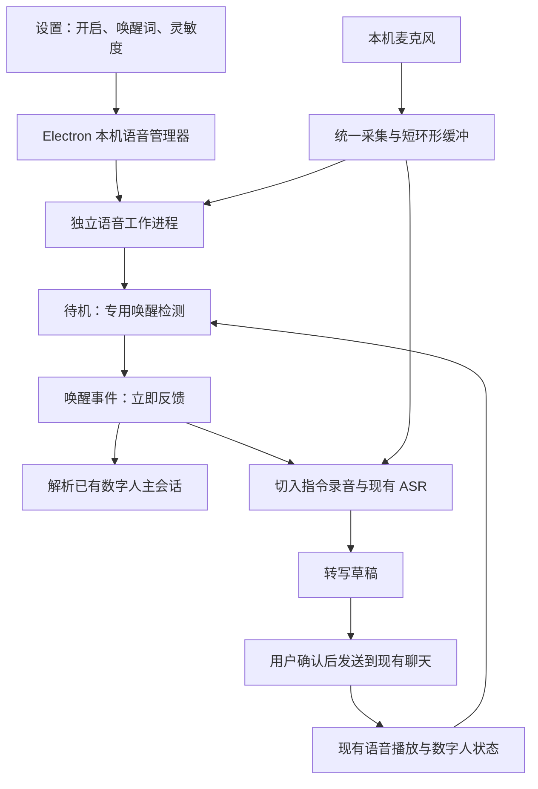

# 数字人本地语音唤醒方案

日期：2026-11-13。

状态：待实施。本文确定接入方向与验证要求，不代表专用唤醒、后台常驻或连续语音对话已经实现。本次仅编写方案。

## 目标与结论

将当前“持续语音识别后匹配文字”替换为本机专用关键词检测。支持配置中文唤醒词，检测后立即给出提示音或数字人状态反馈，再进入现有数字人主会话。

优先实现 Electron 桌面端。唤醒发生在用户设备，不能依赖远端 daemon 接收全部待机音频。专用模型常驻、连续接收音频；不等待一句话结束，不反复启动模型，不以大模型判断是否被叫到。

专用唤醒技术成熟，但具体词语、麦克风、噪声和播放回声仍需实测。唤醒成功、指令转写完成和大模型开始回答是三个独立延迟指标。

## 当前实现基线

2026-11-13 核对 `docs/code-map.md` 与 `apps/web/src/components/digital-person/DigitalPersonWake.tsx`：

- `DigitalPersonWakeController` 挂在 Layout，复用 `useVoiceInput` 获取转写结果，通过 `wakeMatches` 匹配姓名／唤醒词。
- 录音每 20 秒定稿并重新启动；20 秒是分段上限，不是必须等满 20 秒才检测。
- 现有采集链路通过 `utils/voiceCapture.ts` 与 AudioWorklet 获取音频，按 0.5 秒聚合送入识别链路；这不是专用唤醒所需的小帧持续检测。
- `services/speech_runtime.py` 已用独立子进程隔离语音识别，可复用其资源管理经验，但不能直接把完整 ASR 当作低功耗唤醒模型。
- 当前匹配成功只打开主会话，不自动发送；页面隐藏、刷新或关闭数字人会撤销监听。
- 服务端 `/voice-wake` 的宿主常驻能力尚不可用；浏览器监听和宿主监听不能混报。
- 当前输出使用系统语音。现有嘴部动画按播放状态变化，不是音素级口型。

## 桌面端架构

职责约束：

1. Electron 本机语音管理器持有设备范围的启停、权限、配置和工作进程生命周期。主进程只编排，不运行推理或阻塞采集。
2. 独立语音工作进程承载关键词推理。采集可以由同一原生工作进程或专用音频宿主持有，选型验证后固定一种实现；不能依赖主聊天页面保持可见，也不能在两处分别开麦。
3. 统一音频入口负责设备选择、格式转换、时间戳、有限缓冲及唤醒／指令模式路由。手动录音具有明确的占用协调，避免重复采集、两份上传和串音。
4. 唤醒事件只携带检测 ID、词条 ID、音频边界、时间与必要分数；不把待机原始音频送入聊天事件总线或持久化。
5. 主会话继续使用 `digitalPersonChat.ts` 与现有服务端绑定，不另建数字人聊天运行时或引擎调用链。
6. ASR 复用现有识别服务。若服务在远端，指令音频只在进入录音状态后按明确配置发送；待机音频始终本机处理。

与前面“前端采集 → daemon 唤醒子进程”的过渡方案相比，本方案将桌面唤醒固定在设备端，避免远端网络和页面后台生命周期成为唤醒前提。本地管道／IPC 是常驻通信，不随音频帧创建进程。

## 网页与移动端边界

- 网页后续采用 AudioWorklet 采集、Web Worker 中运行 WASM／ONNX 唤醒模型；不在界面主线程推理。仍需验证模型兼容、浏览器内存及调度行为。
- 网页仅承诺页面可运行时的监听；后台冻结、锁屏或关页后不承诺常驻。未实现专用网页模型前明确标注现有模式，不能伪装成桌面能力。
- Android 后台唤醒需要单独设计原生音频生命周期、系统授权及后台服务，不能直接以 WebView 页面持续工作为前提；首期不纳入交付。
- 状态返回区分本机引擎可用、模型就绪、用户已启用、麦克风实际采集中、正在对话。网页与桌面只能有一个监听所有者。

## 模型与自定义唤醒词

首选验证 sherpa-onnx 中文／中英关键词模型及 INT8 路径：现有语音识别已经采用该技术栈，且其关键词模型支持配置关键词。唤醒模型与 ASR 模型是不同资源，不能共用同一份模型配置冒充支持。

备选 Porcupine：支持普通话及生成专用唤醒词模型。采用前核实目标平台、商业授权、凭据要求、模型生成与离线运行条件。openWakeWord 官方以英文支持为主，不作为首期中文默认实现。

- “你好小步”等词条需要转换为目标模型要求的词元／发音表示；不是所有任意中文字符串都能得到相同识别效果。
- 配置前校验空值、长度和模型词元覆盖；无法支持时说明原因，不悄悄回退为完整 ASR。
- 建议提供经过测量的默认词，并允许测试自定义词。短词、常用词与相近发音更容易误触发，保存后须提供真实麦克风试唤醒。
- 灵敏度映射为检测阈值等真实模型参数，不沿用“转写包含／模糊匹配”冒充模型灵敏度。
- 更换配置使用版本号与检测代次，旧进程迟到结果不能触发新配置；不因改词重复加载多个后台实例。
- 参数量／模型文件大小不是进程内存；测试须计入运行库、采集组件与缓冲，不引用其他引擎的性能作为本方案成绩。

## 音频连续性与状态机

状态：关闭 → 初始化／授权 → 待唤醒 → 指令录音 → 转写／确认 → 回答／播报 → 待唤醒。权限拒绝、设备断开、模型错误和进程退出进入明确错误状态，不无限重启、不显示虚假监听。

- 采集使用模型要求的采样率及小块音频，初始评估 20～40ms 调度批次；实际推理窗口由模型决定，小批次不等于承诺同样短的唤醒延迟。
- 内存保留约 2 秒的有界环形缓冲，参数经实测调整；16kHz、单声道 PCM16 下约 64KB，仅指原始采样，不含其它内存。
- 检测结果提供唤醒词边界时，利用边界与缓冲衔接“你好小步，帮我看看任务”，避免把指令开头丢掉或重复提交。边界不可靠时需验证裁剪策略，不以字符串删除代替音频对齐。
- 切换到 ASR 时保持采集连续，ASR 冷加载期间用有限队列暂存；超限显示错误，不静默丢字。可预热 ASR，但其额外内存必须单独计量，不能计入“小模型低占用”的宣传。
- 首期转写写入主会话草稿，用户确认发送；普通 `ChatInput` 原有转写不自动发送的规则保持有效。后续全语音模式必须由用户单独启用，定义停顿定稿、取消和一次发送语义。
- 同一检测只响应一次；录音和发送期间抑制重复唤醒，模式返回时清空过期模型状态。
- 用户关闭监听立即释放音频流和工作进程；重启应用不静默恢复录音。最小化监听需用户明确开启，锁屏／休眠停止采集，恢复后显示真实状态并按用户操作重新启用。

## 播放回声与打断

首期允许播报期间暂停唤醒，结束后恢复，明确该阶段不支持随时打断；不能同时宣称已实现全双工对话。

后续实现自然打断时接入扬声器播放参考信号做回声消除，再配合语音活动检测、必要的二次确认及抑制策略。VAD 只能判断是否有语音，不能单独证明用户正在对数字人讲话。重点测试数字人自己念出唤醒词、音乐／视频包含名字及多人说话场景。

## 生命周期、权限与资源管理

- 只接受可信界面发起的 IPC；配置及事件使用白名单结构，不允许前端传入任意可执行文件或模型路径。
- 模型通过固定清单下载、校验哈希，存独立运行资源目录；沿用已有宿主范围授权，不恢复 `engine.install` 门槛，不允许项目身份管理宿主模型。
- 新进程接入现有归属与回收机制，应用退出时关闭麦克风、管道及模型进程。故障恢复有界，失败后需要用户重试；不能按进程名批量终止程序。
- 后台和数据库接口遵循异步隔离，文件／下载／模型加载不阻塞事件循环。数据库状态如有需要通过项目 `run_db` 完成。
- 不保存待机录音或待机转写；诊断仅保留有界耗时、队列长度与错误码。测试报告和采样脚本统一放 `tmp/digital-person-voice-wake/`，不得把私密录音提交到 Git。

## 实施阶段与测试

1. **可行性验证**：在本机独立验证中文模型、改词、麦克风采集、常驻推理与许可。先确认目标平台和模型版本，再确定采集宿主；记录下载体积、冷启动和整个工作进程 RSS。
2. **桌面专用唤醒**：测试先行覆盖进程生命周期、配置代次、重复检测、权限拒绝和手动录音抢占；接入现有主会话解析及即时反馈，替换桌面旧转写匹配路径。
3. **接话衔接**：覆盖连续说词与指令、冷启动缓冲、无声超时、草稿归属、取消、切会话和迟到结果，不自动发送。
4. **后台与故障**：覆盖最小化、关主窗口但应用驻留、退出、休眠、设备拔插、模型崩溃及恢复；实际运行验证，不能只靠模拟 IPC 判定后台监听可用。
5. **连续对话与打断**：独立阶段增加显式全语音模式、停顿定稿、回声消除和播放中断；之前阶段验收不依赖尚未实现的全双工能力。
6. **网页及其它平台**：单独验证本机浏览器推理和系统限制，通过的平台才开放对应能力。

行为测试归属实际模块，复用现有语音、数字人会话及桌面权限回归。新增后台 I/O 路径提供慢操作与健康检查 canary。实现时同步 `docs/code-map.md`、中文文案及全语言键集合；实际渲染检查覆盖监听状态与错误提示。手册与正式截图在合并交付节点集中同步。

## 性能与体验验收

以下均为首轮工程目标，不是已测结果或跨设备承诺。报告必须写明操作系统、CPU、麦克风、距离、模型版本、线程数和样本数量。

| 项目 | 首轮目标／记录方式 |
| --- | --- |
| 热态唤醒反馈 | 唤醒词实际说完至提示音／视觉反馈，P95 ≤ 500ms；分别记录检测和反馈延迟 |
| 待机 CPU | 目标平均 ≤ 单逻辑核心的 5%，统一以单核心 100% 口径报告；超标先定位采集、推理或 IPC |
| 待机内存 | 专用语音进程及必要辅助组件合计 RSS 初始预算 ≤ 150MiB，同时记录增量与峰值；不含 ASR 预热，后者单列 |
| 持续运行 | 连续 8 小时，无无限增长、音频积压或重复进程；同时记录能耗／唤醒次数 |
| 安静近场漏唤醒 | 多人多次、至少 200 次正样本，初始目标 ≤ 5%；逐词报告 |
| 误唤醒 | 至少 10 小时非唤醒语音／音乐／环境声，初始目标 ≤ 0.1 次／小时；样本有限，不能当长期统计保证 |
| 噪声与远场 | 1m／3m、音乐和不同口音分组记录，不以安静近场结果代替 |
| 接话完整性 | 连续说唤醒词与指令，不因模式切换丢失或重复指令开头 |
| 对话总延迟 | 单列 ASR 首字、停顿至定稿、大模型首字和语音首声，不混入唤醒延迟 |

任一关键目标未达到时，记录实际值与原因，调整模型或采集路径；不能通过过度降低阈值换取速度、同时忽略误唤醒。未完成真机和长时间测试前只标为试用。

## 参考资料

- [sherpa-onnx 关键词检测与中文模型](https://k2-fsa.github.io/sherpa/onnx/kws/index.html)
- [Porcupine 自定义词模型与语言／平台](https://picovoice.ai/docs/model-api/porcupine/)
- [Porcupine 性能说明](https://picovoice.ai/docs/faq/porcupine/)：厂商数据，仅供选型参考。
- [openWakeWord 官方仓库](https://github.com/dscripka/openWakeWord)：语言支持与性能说明。
- [Apple 两级低功耗唤醒架构](https://machinelearning.apple.com/research/hey-siri)：架构参考，不能视为普通电脑具有相同硬件能力。
- [现有语音输入方案](voice-input.md)
