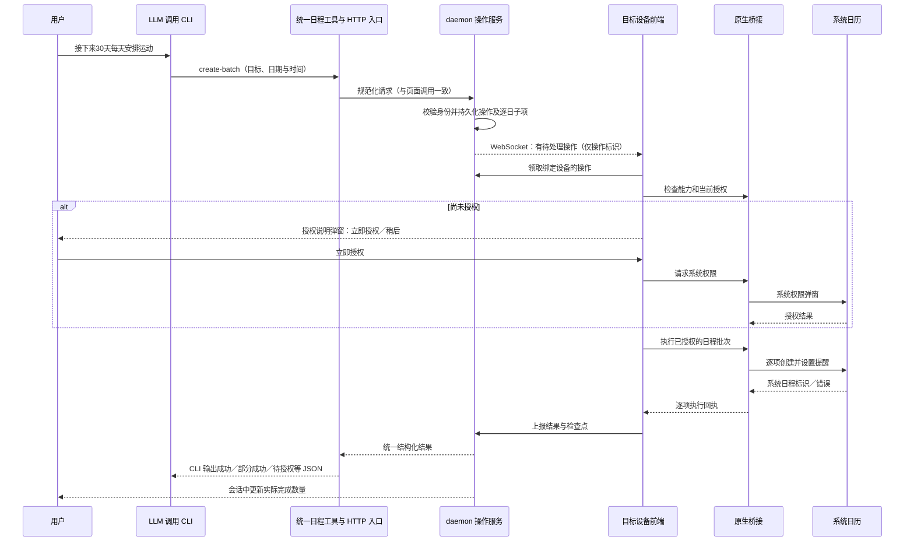

# 系统日历接入技术方案

状态：统一协议、CLI、前端授权和安卓／macOS 适配代码已实现；真实系统权限、日历读写、通知及签名安装包仍待验收。现行职责与验证边界见 [系统日历](../docs/native-calendar.md)。下文保留设计约束，不能将代码接入等同于真机验收完成。

## 决策

- 使用结构化日程工具和设备操作协议；聊天正文、Markdown、历史消息重放都不作为执行指令。
- daemon 创建持久化操作，专用设备 WebSocket 定向通知前端，前端调用原生桥接，原生包访问系统日历。系统返回结果后才确认成功。
- 首期安卓和 macOS；iOS 保留相同协议，在有对应客户端后适配；Windows 经能力验证后接入，不能默认支持。
- 首期管理 WorkStep 创建的系统日程，不做全部日历的双向同步。已有内部日历继续可用；目的地明确，不能在系统调用失败时悄悄改存内部。
- 指定未来 30 天先展开为 30 条独立日程，共用计划标识。无限重复、重复系列单次例外后续单独实现，不假报支持。

## 调用链与现有接缝



现有接缝：桌面 `apps/desktop/src/preload.cjs` 已通过 contextBridge + IPC 暴露原生能力；安卓 `MainActivity.java` 已使用限定来源和主框架的 `WebViewCompat.addWebMessageListener`。日历各增加窄接口 `calendar.status/requestPermission/listCalendars/execute/openSettings`，不开放任意代码执行。前端桥接执行器挂载在已认证应用外壳，不依赖数字中枢页面或日历弹窗是否打开。

现有 `/ws` 是可广播的业务事件流，不能直接发布包含日程内容、任何客户端收到就执行的 CUSTOM 事件。采用宿主范围 `/ws?calendar_device=1` 专用模式（复用现有 Gateway 的 `/ws` 路由及查询串转发），只接受已登记且能证明安装身份的原生客户端；复用已有登录／网关传输认证，再绑定安装设备凭证。客户端自报的 device_id 不能构成授权。

WebSocket 只发操作就绪、授权状态、进度变化等短通知；操作领取、结果提交和恢复通过已认证 API。设备内容不经过全局 EventBus 广播，也不混入会话历史。断线后按持久化操作恢复，不依赖 WebSocket 消息必达。网关须同步开放专用宿主路径，项目分享和公开分享不可访问。

## 统一 Module 与 Interface

下面名称是拟定接口，不是现有可调用能力。只在实际存在变化的接缝设置 Adapter：内部存储与原生设备执行不同；安卓与 macOS 的系统调用不同。CLI、前端、平台适配器不各自维护日期解释、重试或成功判定。

| Module | Interface 与职责 | 不向调用方泄漏的 Implementation |
|---|---|---|
| CalendarApplication | targets、query、submit、operation、cancel；统一宿主授权、目标选择、展开日期、校验、版本、幂等、操作状态、关联及回执收敛 | SQLite、设备路由、平台系统标识、失败恢复 |
| CalendarExecution | 执行规范化操作并返回标准回执；Internal Adapter 在现有数据库执行器内完成，Device Adapter 进入持久化设备队列 | 内部和原生执行方式的差异；不负责解释自然语言 |
| CalendarHostBridge | status、requestPermission、listCalendars、execute、openSettings；前端调用同一 Interface | Electron IPC 或安卓受信 WebMessage 传输 |
| NativeCalendarProvider | capabilities、authorization、calendars、query、create、update、delete；由原生执行器调用 | Android CalendarContract、macOS EventKit；未来 iOS 等 Adapter |

CalendarHostBridge 的 execute 是统一入口，负责子项串行执行、原生幂等日志、权限重新校验、系统回读和待上传回执，返回结果／进度；不是“收到就成功”的无返回广播。授权方法只能由明确用户操作发起，execute 不偷偷弹权限窗口。NativeCalendarProvider 只处理系统对象与平台错误，不关心聊天、CLI、WebSocket、后端数据表。

前端的设备执行器负责领取、转发、授权 UI、上传和重连恢复，不作系统成功判定，也不更新后端数据库事实。最终业务状态统一由 CalendarApplication 根据原生核验回执提交。各 Module 用注入的 Interface 联测，替换原生 Adapter 即可测试失败、延迟和断线，不需为每个平台复制整条链。

### 对外契约

- `targets()`：返回 opaque `target_id`、设备显示名、日历显示名、能力、连接状态、权限状态及检查时间。target_id 在后端映射 actor／宿主／安装设备／日历，模型不拼装系统原始标识；权限状态仍须原生每次重查。
- `query(target_id, range, plan_id?)`：按分钟时间范围查询；原生需要设备执行时可返回 operation_id。明确区分 `verified_at` 和缓存状态，不能将离线缓存称为实时查询。
- `submit({request_id,target_id,action,payload,expected_revision?})`：action 为 create/update/delete，单条和批量共用规范化处理。规范化 payload 为不超过 100 条的明确子项，批次、日期、内容和分钟时间均由后端验证后固定。
- `operation(operation_id)`：返回批次和逐项状态、实际完成数量、可采取的下一步操作。`cancel(operation_id)` 只停止未执行子项，不等于撤销已经完成的系统写入。
- request_id 与调用者／目标／载荷哈希绑定，相同标识不同载荷返回冲突；单条请求也有 operation_id。由运行时来源标识或 CLI 显式参数提供稳定幂等键，不能按日期、标题或模型重新生成的随机值判断同一操作。

统一返回至少包括 `operation_id/status/target_id/plan_id/items/next_action`。每个子项包括 `occurrence_id/status/event_id/revision/verification/error_code`；event_id 是 WorkStep 不透明标识，原生系统标识仅由内部关联和原生执行使用。状态枚举见可靠性章节。next_action 为 request_permission/select_calendar/open_device/reconcile/retry 等，前端按枚举呈现，不能解析模型文案生成按钮。

错误码统一使用 permission_required、permission_denied、device_offline、calendar_unavailable、not_supported、conflict、provider_error、verification_unknown。平台原始错误映射到这些值，展示本地化文案；不把任意平台异常交给模型猜测成功与否。

### CLI、工具与页面复用

当前 `cli.py` 已经通过 `WorkstepClient.call` 调用 `tool_registry.py` 的统一工具，再映射到 HTTP。沿用这条链，不增加“CLI 直接读手机／桌面日历”的旁路。页面调用同一 HTTP 日程 Module；平台差异完全不进入 CLI 和页面表单。

拟定新增命令（以下省略技能文档中的统一启动前缀）：

```text
digital-hub calendar targets --json
digital-hub calendar create-batch --target <target_id> --start-date 2030-01-01 --end-date 2030-01-30 --time 08:00 --timezone Asia/Shanghai --duration-minutes 30 --content-file <markdown-file> --request-id <key> --json
digital-hub calendar list --target <target_id> --since <ISO8601> --before <ISO8601> --json
digital-hub calendar delete-occurrences --target <target_id> --plan <plan_id> --dates 2030-01-05,2030-01-12,2030-01-19 --request-id <key> --json
digital-hub calendar operation get --id <operation_id> --json
digital-hub calendar operation cancel --id <operation_id> --json
```

批量新增／按日期删除是不同的输入方式，进入 CalendarApplication 后均归一为 submit，不各自拥有执行状态机。批量修改沿用相同规范化子项，要求 event_id 和版本；CLI 和工具注册必须一起具备查询、新增、修改、删除及状态查询，不能只接新增。

既有单条 create/get/update/delete 的命令和 REST 返回格式保留，未选择系统目标时默认内部日历；通过兼容入口调用同一业务 Module，不复制已有行为。需要等待设备的新增 Interface 使用统一操作返回，不能悄悄把旧的 CalendarEvent 响应类型改成 queued。迁移后现有内部日历行为测试必须继续通过。

### 设备传输契约

| 通道 | 负责的消息 | 成功依据 |
|---|---|---|
| 专用 WebSocket | `operation_available {operation_id}`、状态／进度变化 | 仅表示通知已发出，不表示系统执行 |
| 操作领取 HTTP | 校验绑定设备、执行所有权后领取规范化子项 | 仅表示设备已领取 |
| 原生桥接调用 | 执行并核验，返回逐项原生回执 | 本机系统操作及核验结果 |
| 回执 HTTP | 提交 operation_id、子项、回执序号、执行凭据、核验结果 | 后端持久化并确认接收后提交业务状态 |

拟定宿主入口 `/api/digital-person/calendar/targets`、`/operations`、`/operations/{id}`、`/operations/{id}/cancel`。安装登记、领取、上传和待处理恢复使用独立设备范围入口 `/api/device-actions/...`，必须同时校验宿主身份与设备凭据，不能让普通宿主浏览器冒充任意手机提交成功。

每个回执携带稳定子项标识和单调序号，后端对重复回执幂等确认；乱序、旧所有权和内容不匹配的回执不能倒退状态。后端 HTTP 应答丢失时，原生保留待上传记录并重试，前端重开后可从原生队列继续；只在 JavaScript 内存保存回执不满足要求。后端收到核验成功回执，才更新关联并以 operation_id 去重更新来源会话；CLI 短等待超时返回 pending，不阻塞模型直到用户授权。

## 工具与数据协议

保留上层查询、新增、修改、删除语义，内部日历、原生日历复用工具注册入口。target_id 统一选择目的地，内部解析 destination、device_id、calendar_id；批量操作避免模型逐天生成 30 次工具调用。状态查询使用 operation_id。

创建示意（字段名为拟定契约）：

```json
{
  "request_id": "稳定的用户请求标识",
  "target_id": "已登记的目标设备及可写日历引用",
  "content": "运动\n\n- 快走半小时",
  "timezone": "Asia/Shanghai",
  "schedule": {
    "start_date": "2030-01-01",
    "end_date": "2030-01-30",
    "time": "08:00",
    "duration_minutes": 30
  },
  "reminder_minutes": 0
}
```

- daemon 按目标设备的明确时区展开本地日期，时间只到分钟；跨夏令时不能按 UTC 每次加 24 小时。相对日期由权威当前时间解析，结果显示首末日期和条数；缺少时间、日期范围不清或夏令时歧义时才询问。
- 内容仍使用通用 Markdown，不新增必填名称。系统标题取内容首行的纯文本摘要，完整内容保留；系统日历备注不能保证渲染 Markdown。系统需要结束时间时使用设置中可见的默认时长（首期 30 分钟），用户可指定。
- 每批最多 100 项，30 天属于单批；后端先验证完整计划，再执行。可排除指定日期；不是为了批量就申请 30 次权限。
- 操作记录保存 actor、来源会话／消息、目的设备／日历、request_id、内容摘要哈希、期限、状态；子项保存 occurrence_id、计划标识、日期、操作类型、系统标识、执行状态／回执。关联表保存 WorkStep 标识与原生日历标识、provider、版本／最后核对时间、reminder_owner。
- 日程及设备操作属于宿主数据，沿用宿主范围授权；设备还需绑定当前用户和宿主。原生侧再次核对受信来源、主框架、目标日历、操作类型及载荷限额。
- 已有默认目标时直接使用；设备／日历存在多个且无明确默认时展示一次选择。选择和授权属于每台设备，不能沿用另一台设备的授权状态。

## 指定某几天删除

用户说“删掉这个计划 1 月 5 日、12 日和 19 日”，工具先查询计划及具体日期，再提交 `delete_occurrences`，包含计划标识和日期，daemon 读取各条当前版本并找到三条关联，原生侧核对当前系统记录后逐项删除，只更新对应子项，其他 27 天保持原样。

如果是不同请求创建的同名计划，不能只凭“最近一条”或标题猜测，需展示可区分的计划让用户选。若创建前已指定排除日期，则生成计划时直接排除，不先新增再删除。

系统中已手动删除的关联记录视为已不存在；已经修改的记录需要重新核对，不以陈旧镜像覆盖。用户明确要求删除其他应用创建的日程属于后续扩大范围，首期工具明确返回不支持。

### 状态权威与删除顺序

原生日程以系统日历为实际状态来源，WorkStep 保存最近核对的展示镜像、关联和操作日志，不维护另一份独立生效的原生日程。操作的目标状态（用户要求删除）与观察状态（系统中仍存在）分别记录，不能用目标状态覆盖事实。

删除固定顺序：持久化待删除操作 → 原生接口删除指定系统标识 → 回读核验该事件／发生实例不存在 → 提交删除回执 → WorkStep 将关联标记为已删除。核验需有有效读取权限且查询成功；权限不足、查询失败、日历不可用不能冒充事件不存在。

- 删除中继续保留条目和系统标识，展示“正在删除”，不先做本地软删除或直接隐藏；已经确认的原生日程不走内部日历 remove 接口。
- 删除失败／设备离线时展示“删除未完成，系统仍可能提醒”，保留条目并支持重试；LLM 不回复已删除。不得因本地隐藏而承诺停止系统提醒。
- 系统已删除但结果未回传时记 unknown；重连后按标识核验不存在即可完成回执，不重建日程、不恢复旧镜像。重复删除已确认不存在的同一事件可收敛为成功。
- 批量删除逐项确认，成功项才移除，失败／未知项继续可见；不能将整个计划标为删除成功。
- 用户在系统日历手动修改／删除时，在应用恢复、用户查询或下一次操作时核对本应用关联，更新镜像；不持续全库双向同步。离线显示“最后核对时间／状态待核实”，不把缓存当实时事实。
- 原生删除成功后的“撤销”属于重新创建，必须再次经过系统写入确认、保存新的系统标识，不能只撤回 WorkStep 的软删除标记。

后续重复规则适配增加 scope=this_occurrence/series 和 occurrence_start。本期的“独立条目批次”与系统重复系列必须明确区分，不用删除系列冒充只删一天。

## 授权与引导

设置／日历入口提供“连接系统日历”，展示平台支持、设备、权限状态和默认日历。聊天工具也能触发同一个引导；它返回结构化 needs_permission，前端直接展示说明弹窗，无需用户自行寻找设置，也不解析聊天文本中的指令。

1. 未授权且应用在前台：显示“需要日历权限，才能在这台设备创建、查看、修改和删除日程”，以及待执行数量／日期范围。“立即授权”调用原生系统权限窗口，“稍后”保留待处理状态。
2. 安卓：声明并请求 READ_CALENDAR、WRITE_CALENDAR，系统回调后重新检查；拒绝且可重试时解释原因，不可再次询问时提供“打开应用设置”。设置返回或应用恢复前台时重查，不能把点击设置按钮当作已授权。
3. macOS／未来 iOS：通过 EventKit 请求完整日历访问，配套权限说明及应用签名／沙盒所需配置；写入专用权限不足以支持查询、修改、删除。授权归属 WorkStep 应用身份，不能用未受控临时脚本代替。
4. 权限通过后，列出可写日历；只有一个可用默认目标时沿用，否则让用户选择。授权弹窗已说明的、尚未过期的原请求可继续执行，不要求用户重发聊天，也不为每条重复确认。
5. 设备离线／安卓在后台不能弹窗：返回 needs_device／waiting_for_foreground，提示打开目标设备。未领取操作默认不在以后突然补做；用户选择“打开后继续”才保留，超过 24 小时过期。已领取但部分完成的批次保留逐项回执，恢复时先核对而非盲重放。
6. 权限被撤销、无可写日历、设备不支持均有明确引导和可取消入口；失败不降级成声称已写入系统。

系统日历事件需同时写入提醒设置。系统日历通知受其自身通知设置影响，不能保证新增事件必然弹提醒；WorkStep 不因此额外索取与读写无关的通知权限。使用其他 WorkStep 自有通知功能时再沿用该功能的权限流程。

## 可靠性与性能

- 操作状态区分 queued、needs_permission、needs_calendar、executing、succeeded、partial、failed、unknown、cancelled、expired。LLM 只根据结构化回执报告结果；待授权／排队不等于创建成功。
- 30 条日程使用一批操作、30 个稳定子项标识，原生执行器串行或小批执行，逐项落盘进度。多个窗口只有一个有效设备执行器；领取操作需有所有权令牌，原生侧持久化子项幂等记录。
- 重试只处理确定未执行／失败的子项，成功的不再创建。原生系统写入与本地回执无法跨数据库原子提交：崩溃窗口记 unknown，先核对，不能宣称绝对 exactly-once，也不能在超时后直接重新创建。
- 批次无跨平台原子事务，不因第 20 项失败就自动删除已经成功的 19 项。报告“成功 19、失败 11”等逐项结果，提供重试失败项／删除本批已创建项的明确操作。
- 用户撤销或取消时停止尚未执行子项；在途系统调用须核对实际结果。未完成写入前的取消不等于已写入条目被撤回。
- 等待授权不占用模型运行槽、数据库事务或工作线程。工具短等待，未完成则返回 operation_id，最终结果按该标识去重更新来源会话；不为进度再次启动 LLM。
- daemon 的文件／数据库 I/O 通过现有执行器隔离；原生日历查询、批量写入在后台队列，不阻塞安卓主线程、WebView 或 Electron 主事件循环。权限窗口才切到 UI 线程。
- 空闲时无日历轮询；连接复用心跳，不读日历。按请求查询时间范围，重连只恢复在途操作；批量进度节流，不逐字段刷屏。

## 与提醒及内部日历的关系

原生写入确认后，关联记录标记 `reminder_owner=system`；系统负责设定时间的提醒，不能把“提醒已配置”误写为“已通知送达”。WorkStep 独立分钟调度只检查 internal 归属，不重复推送原生日程。

主动思考仍可查询未来 30 分钟日程，核对原生记录后进行有回执去重的提前关照；目标设备离线且镜像无法核实时不据陈旧数据主动提醒。内部日历继续沿用现有分钟调度。权限不足的原生草稿不算已保存日程，须以待授权操作展示。

## 阶段与验收

1. 协议与状态：设备绑定、定向投递、幂等／部分失败恢复、宿主授权；受控原生适配器验证完整调用链。
2. 安卓真机闭环：一次授权、选择日历、单条及 30 天创建、指定三天删除、系统提醒；同一请求重试无重复。验证拒绝、设置返回、后台、离线、权限撤销和进程重启。
3. macOS 真包闭环：签名及应用身份授权，复用相同工具／状态协议，重复上述场景。不以开发脚本通过代替安装包验收。
4. 后续系统重复系列单次例外、iOS 客户端、Windows 能力验证及扩大日历读取范围，单独交付。

性能验收覆盖慢系统日历／数据库锁竞争下聊天与轻量 API 响应、原生 UI 可交互、每批 30 项的进度与内存、多个前端不能重复执行。前端授权引导需实际渲染和真机权限检查；模拟接口通过不代表系统日历验收通过。

删除一致性必须覆盖：系统删除失败但本地不得消失、系统删除成功但回执丢失、核验时权限撤销、批量部分失败、系统手动删除及删除后撤销重建。不得以接口调用已发出代替删除成功证据。

## 官方接口依据

- [Android Calendar Provider：增删改查、提醒与后台线程](https://developer.android.com/identity/providers/calendar-provider)
- [Android 运行时权限请求与拒绝处理](https://developer.android.com/training/permissions/requesting)
- [Apple EventKit 日历访问授权](https://developer.apple.com/documentation/eventkit/accessing-the-event-store)
- [Apple EKEventStore 保存与删除](https://developer.apple.com/documentation/eventkit/ekeventstore)
- [Windows AppointmentCalendar](https://learn.microsoft.com/en-us/uwp/api/windows.applicationmodel.appointments.appointmentcalendar?view=winrt-28000)
